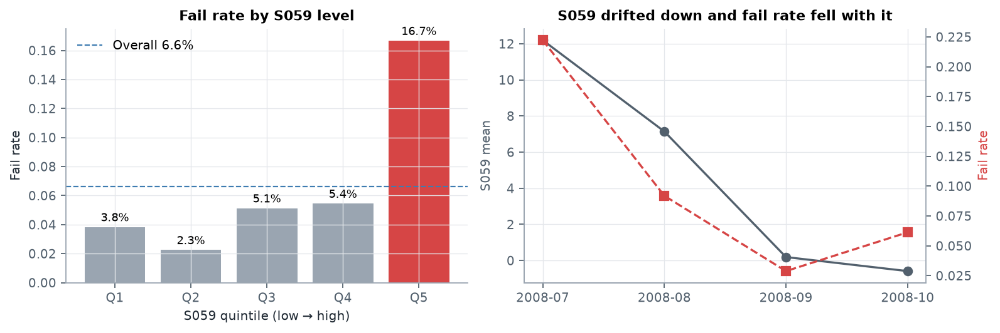
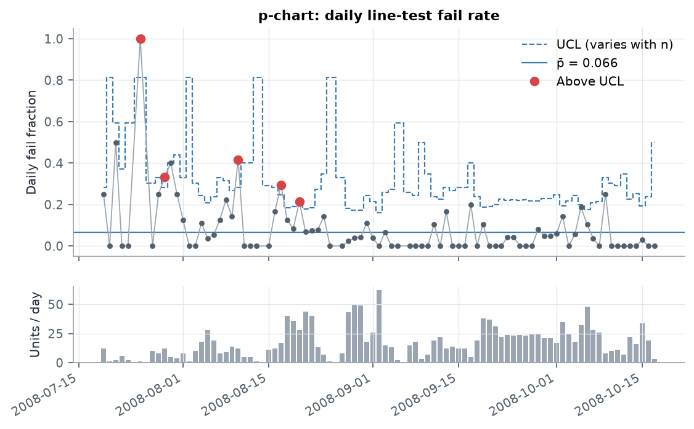
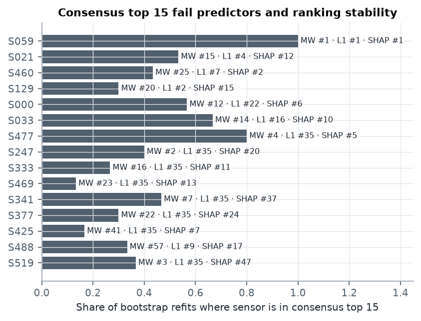
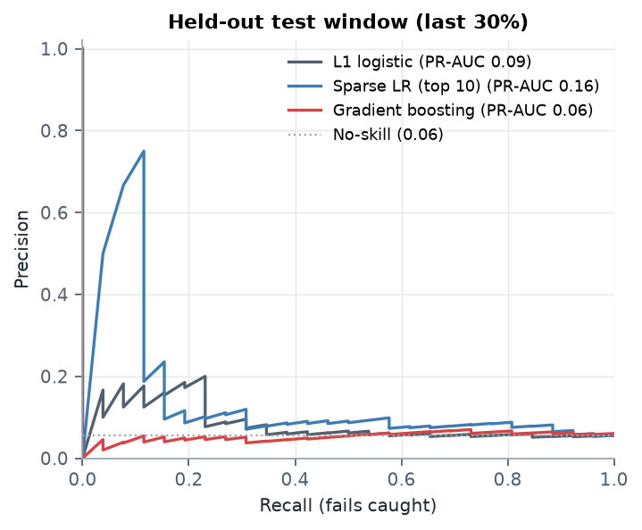
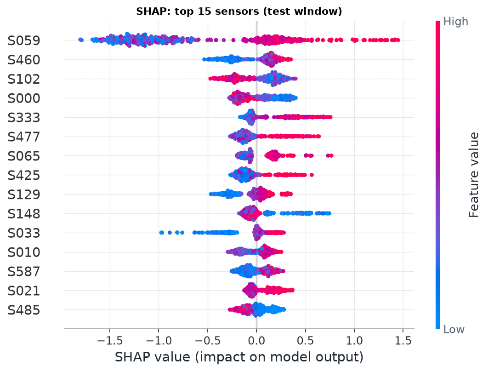
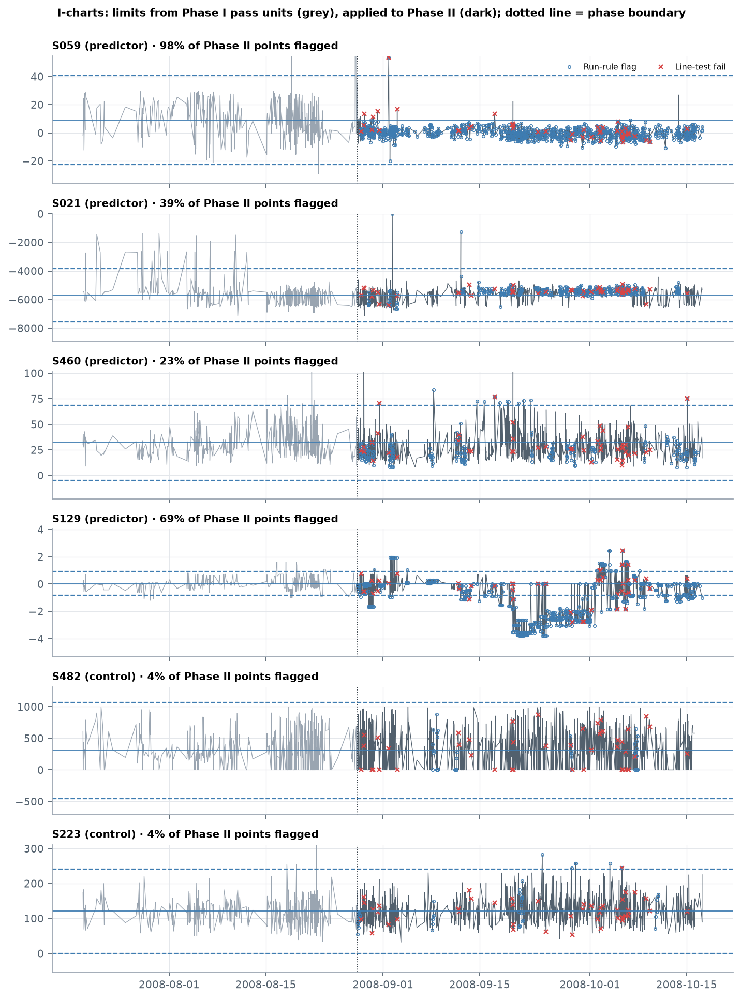
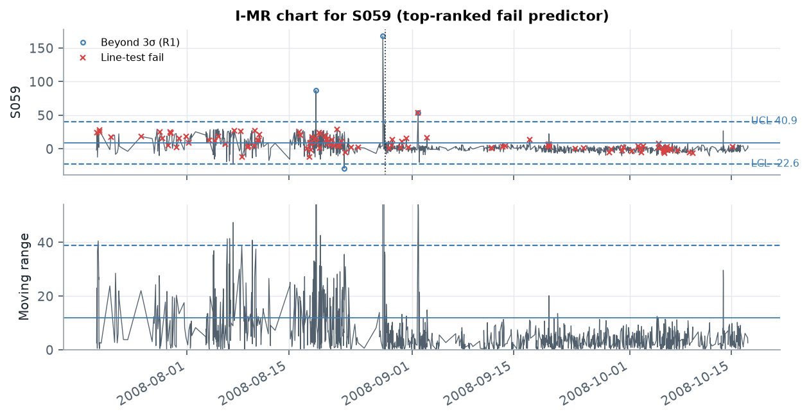
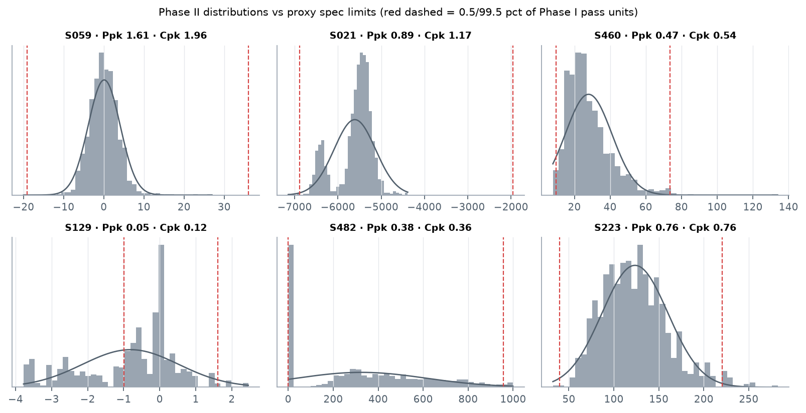

# SECOM: SPC, process capability and yield drivers on semiconductor inline data

Control charts, Cp/Cpk/Pp/Ppk and a ranking of the inline sensors that predict line-test fails, built on the public [UCI SECOM dataset](https://archive.ics.uci.edu/dataset/179/secom) (1,567 production units, 590 anonymous sensors, pass/fail label and timestamp, July to October 2008).

## Summary

- **One sensor explains most of the early yield loss.** Units in the top fifth of sensor S059 failed at 16.7%, against 2.3 to 5.4% in the other four fifths. S059 ranked first on all three ranking methods and stayed in the top 15 in all 30 bootstrap refits.
- **The process moved, and yield recovered with it.** S059's monthly mean fell from 12.2 in July to −0.6 in October. Over the same months the fail rate went from 22.2% to 9.2%, 2.9% and 6.1%. All five days above the p-chart's upper limit fall in the first five weeks.
- **Drift is also why fail prediction is hard here.** Cross-validation inside the training window gave ROC-AUC 0.71 to 0.75. On the later, held-out test window the gradient-boosted model fell to 0.51 (chance). A 10-sensor logistic model held up best at 0.65, with PR-AUC 0.16 against a no-skill 0.055.
- **Capability is only meaningful relative to a stable baseline.** SECOM has no spec limits, so I derived proxy limits from the Phase I pass units. The in-control, roughly symmetric sensor S223 scores Pp 0.82, close to the 0.86 an unchanged process would score. The drifting sensors land far from it in both directions.



## Data

| | |
|---|---|
| Units | 1,567 (one row per production unit), sorted by timestamp |
| Sensors | 590 raw, 440 after screening |
| Fails | 104 (6.6%); 78 in the training window, 26 in the test window |
| Period | 19 Jul 2008 to 17 Oct 2008, 86 production days |
| Missing | 4.5% of all cells |

Screening ran on the training window only (first 70% of the timeline) so the test window had no say in which sensors were kept. It dropped 122 constant sensors, 24 with more than 50% missing and 4 near-constant ones (`reports/feature_drops.csv`). No exact duplicate columns remained. Median imputation sits inside each model pipeline, so it is fit on training folds only.

## 1. Yield over time (p-chart)



Daily fail fraction, with limits that widen on low-volume days (p̄ = 0.066). Five days exceed the upper limit: 25 Jul, 29 Jul, 10 Aug, 17 Aug and 20 Aug. The 25 Jul point is a single unit that failed, so it carries almost no information. The other four are real excursions of 4 to 6 fails on 12 to 28 units. Weekly first-pass yield ranged from 76.9% (week of 14 Jul) to 98.9%. After 20 August the line never breaks its upper limit again.

## 2. Which sensors predict fails

Three ranking methods, all fit on the training window:

1. Mann-Whitney U per sensor, with Benjamini-Hochberg FDR control. 22 sensors pass q < 0.05.
2. Absolute coefficients of an L1 logistic regression on standardized sensors (C = 0.03 by CV; 34 sensors kept).
3. Mean |SHAP| from a gradient-boosted tree model.

The consensus rank is the mean of the three ranks. Stability is the share of 30 stratified bootstrap refits in which a sensor made the consensus top 15.



| Rank | Sensor | MW rank | L1 rank | SHAP rank | MW AUC | In top 15 (of 30 refits) |
|---|---|---|---|---|---|---|
| 1 | S059 | 1 | 1 | 1 | 0.76 | 100% |
| 2 | S021 | 15 | 4 | 12 | 0.61 | 53% |
| 3 | S460 | 25 | 7 | 2 | 0.60 | 43% |
| 4 | S129 | 20 | 2 | 15 | 0.60 | 30% |
| 5 | S000 | 12 | 22 | 6 | 0.38 | 57% |

Full table: `reports/top_features.csv`. Only S059 is stable. Below it, ranks move a lot between refits, which is what you expect with 78 training fails spread over 440 sensors.

### Model performance

Time-ordered split: train on the first 70% (to 26 Sep), test on the last 30%. CV columns are stratified 5-fold inside the training window.

| Model | CV ROC-AUC | CV PR-AUC | Test ROC-AUC | Test PR-AUC | Test fail recall |
|---|---|---|---|---|---|
| L1 logistic | 0.74 | 0.15 | 0.54 | 0.09 | 23% |
| Sparse logistic, top 10 sensors | 0.71 | 0.14 | **0.65** | **0.16** | 15% |
| Gradient boosting | 0.75 | 0.21 | 0.51 | 0.06 | 12% |
| Predict "pass" for everything | | | | 0.055 | 0% (accuracy 94.5%) |

The last row is why accuracy is not used: a model that never predicts a fail scores 94.5% accuracy on this test window.

The model that looked best in cross-validation (gradient boosting) was the worst on later data, and the simplest model degraded least. The training window covers the high-fail summer period and the test window the recovered autumn, so the relationship between sensors and fails changed between them. I compared all three models on the test window, so the 0.65 for the sparse model is an optimistic number for "best of three", not a clean holdout estimate.

 

These rankings show correlation with fails, not cause. A fab would follow up by mapping S059 to its tool and step, checking chamber and maintenance logs for late August, and confirming with a designed experiment.

## 3. Control charts (I-MR)

One reading per unit, so individuals and moving-range charts. Limits come from a Phase I baseline (first 30% of the timeline, pass units only) and are applied to the rest as Phase II monitoring. Run rules follow the AIAG list: R1 one point beyond 3σ, R2 nine in a row on one side, R3 six in a row trending, R4 fourteen alternating. σ̂ = MR̄ / 1.128.



| Sensor | Role | Phase II points flagged | Main signal |
|---|---|---|---|
| S059 | top predictor | 97.5% | R2 (1,062 of 1,090 points): sustained shift below the baseline center |
| S021 | predictor | 38.7% | R2 |
| S460 | predictor | 22.7% | R2, 14 points beyond 3σ |
| S129 | predictor | 68.6% | 455 points beyond 3σ; step changes in mid-September and early October |
| S482 | stable contrast | 4.0% | none dominant |
| S223 | stable contrast | 4.4% | none dominant |

S059 shows the main limitation of Phase I limits. Its baseline came from the worst-yield weeks, so its "out of control" Phase II signal was the process moving to a better place. A baseline should come from a period you would be happy to keep running.

Run-rule flags on single sensors were a weak fail detector. For S021, flagged units failed at 6.1% against 3.0% for unflagged units. For S059 the relationship ran the other way, for the reason above (`reports/spc_fail_linkage.csv`).



## 4. Process capability

SECOM gives no spec limits, so these are proxies: LSL and USL are the 0.5th and 99.5th percentiles of the Phase I pass units. For a normal process those sit at ±2.576σ, so a process that has not changed since the baseline scores Pp = 2.576 / 3 = **0.86**. That reference matters more here than the usual 1.33 pass mark, which assumes real customer specs. A ±4σ version is in the CSV as a sensitivity check.

| Sensor | n | Cp | Cpk | Pp | Ppk | Percentile Cpk | Pp / 0.86 | In control |
|---|---|---|---|---|---|---|---|---|
| S059 | 1,090 | 2.81 | 1.96 | 2.31 | 1.61 | 1.45 | 2.69 | No |
| S021 | 1,096 | 2.27 | 1.17 | 1.72 | 0.89 | 1.05 | 2.00 | No |
| S460 | 1,096 | 0.95 | 0.54 | 0.81 | 0.47 | 0.57 | 0.95 | No |
| S129 | 1,094 | 0.83 | 0.12 | 0.32 | 0.05 | 0.16 | 0.38 | No |
| S482 | 1,073 | 0.53 | 0.36 | 0.55 | 0.38 | 0.94 | 0.64 | Yes |
| S223 | 1,097 | 0.82 | 0.76 | 0.82 | 0.76 | 0.73 | 0.96 | Yes |

How to read it:

- **S223** is in control and scores Pp 0.82, close to the 0.86 reference. Nothing changed, as expected.
- **S482** is in control, but its normal-theory Pp of 0.55 understates it. The sensor has a floor at zero and is far from normal, and the percentile method (Cp 0.96) fits it better.
- **S059** and **S021** have Pp well above the reference because their Phase II spread is much tighter than the noisy summer baseline. Cpk is below Cp for both because the mean moved off the baseline center.
- **S129** has Ppk 0.05. Its mean stepped outside the baseline range, which matches the 455 points beyond 3σ on its chart.
- All six fail the Anderson-Darling normality test at 5%. That is why the table includes the percentile indices, and why none of these sensors should get a normal-theory capability claim.
- Capability is only valid for an in-control process (AIAG), so only S482 and S223 have interpretable numbers. The other four are shown to make the point.



## Reproduce

```bash
make setup     # venv + pinned requirements
make all       # unit tests, then the full run (about 10 minutes)
make fast      # 5 bootstrap refits instead of 30
```

Outputs go to `reports/` (CSVs and `results.json`) and `reports/figures/`. The random seed is fixed at 42.

### Same charts in Minitab

`reports/minitab_export.csv` has one row per unit with `timestamp`, `phase` (I or II), `fail` and the six charted sensors. `reports/minitab_spec_limits.csv` has the proxy limits.

1. I-MR: Stat > Control Charts > Variables Charts for Individuals > I-MR. Under I-MR Options > Estimate, list the Phase I pass rows as the rows to estimate from. Under Tests, turn on the tests for one point beyond 3σ, nine points on one side, six points trending and fourteen alternating. Minitab numbers its tests differently from AIAG, so match them by description, not number.
2. Capability: Stat > Quality Tools > Capability Analysis > Normal, using the Phase II rows and the LSL/USL from the spec file. Use Capability Analysis > Nonnormal for the skewed sensors.

I wrote and tested the formulas in Python only. I have not run these steps in Minitab.

## Code

```
src/secom/load.py        reads the raw files, sorts by time, recodes -1/1 to pass/fail
src/secom/clean.py       missing, constant, near-constant and duplicate screening
src/secom/spc.py         I-MR limits, p-chart limits, run rules R1-R4 (numpy/pandas)
src/secom/capability.py  Cp, Cpk, Pp, Ppk, percentile capability, Anderson-Darling
src/secom/model.py       pipelines, CV, Mann-Whitney + FDR, SHAP, bootstrap stability
run_all.py               runs everything and writes reports/
tests/test_spc.py        13 tests against hand-calculated control limits and Cp/Cpk
```

The SPC and capability code uses no SPC library, so every number traces back to a formula in two short files.

## Limitations

- Sensors are anonymous, so no finding can be tied to a physical step.
- Proxy specs make capability a comparison against the baseline period, not against what the customer needs.
- 104 fails is a small sample. Only the S059 ranking is stable across bootstraps.
- Labels are a single pass/fail at line test, with no fail mode.

## Data source

SECOM dataset by Michael McCann and Adrian Johnston, from the [UCI Machine Learning Repository](https://archive.ics.uci.edu/dataset/179/secom), licensed under [CC BY 4.0](https://creativecommons.org/licenses/by/4.0/). The files in `data/raw/` are unmodified copies.
